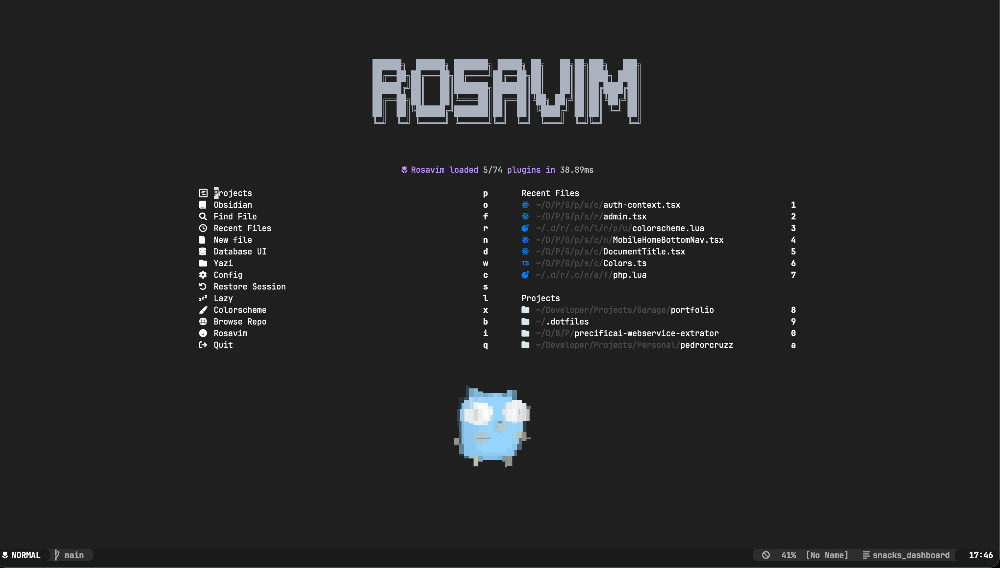
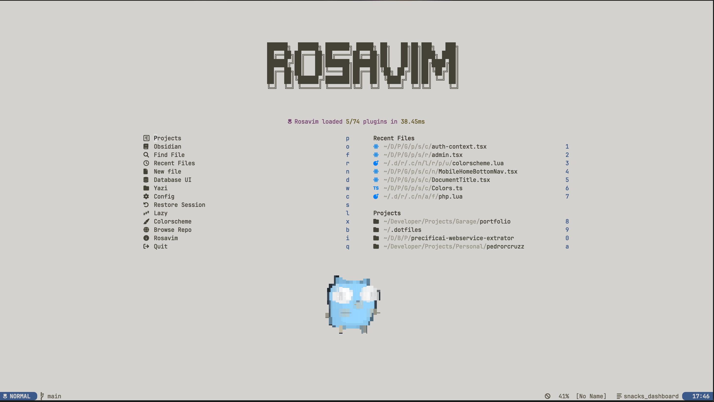
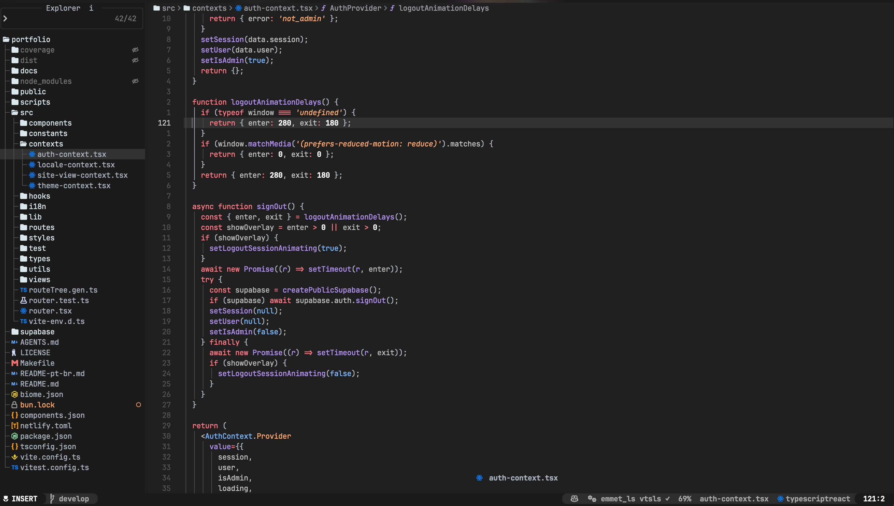
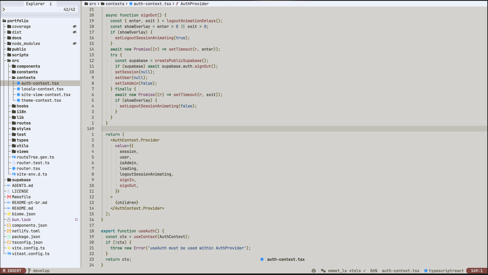
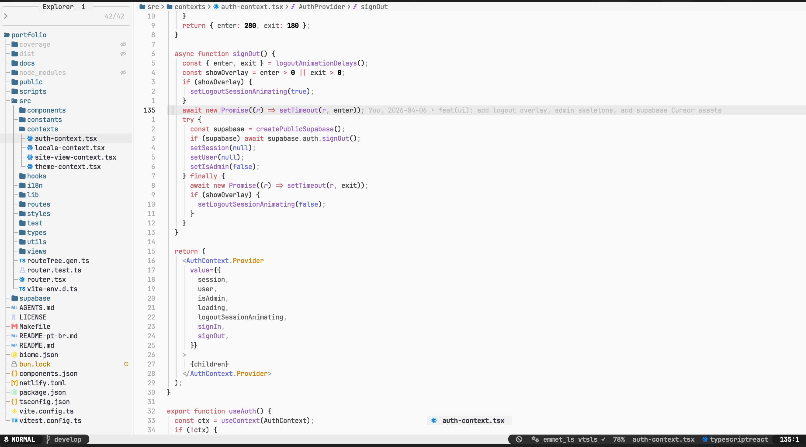
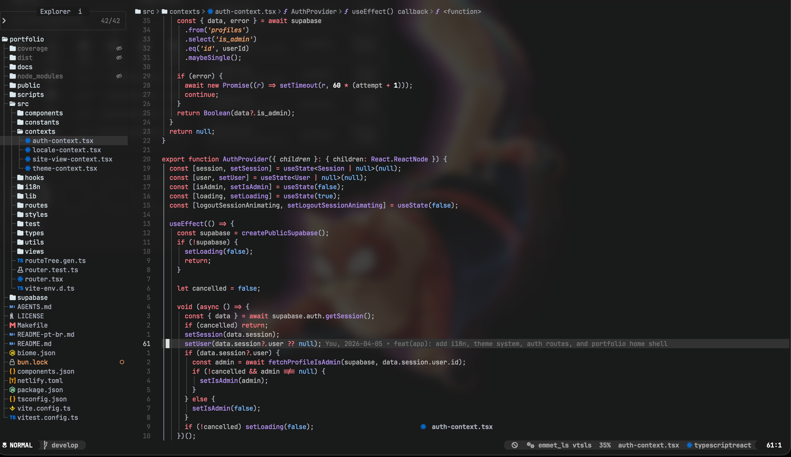
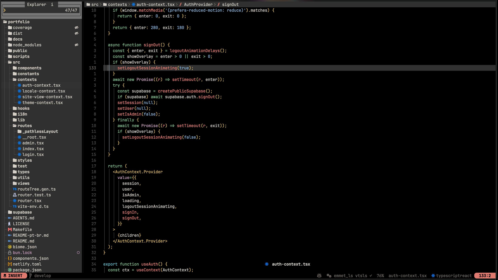
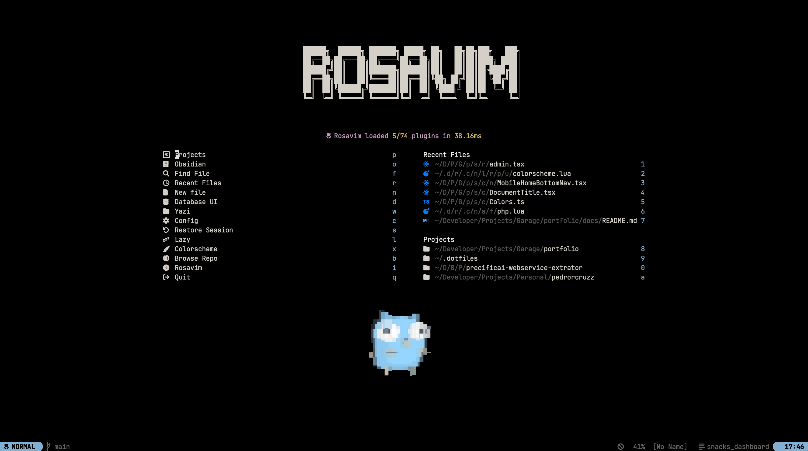
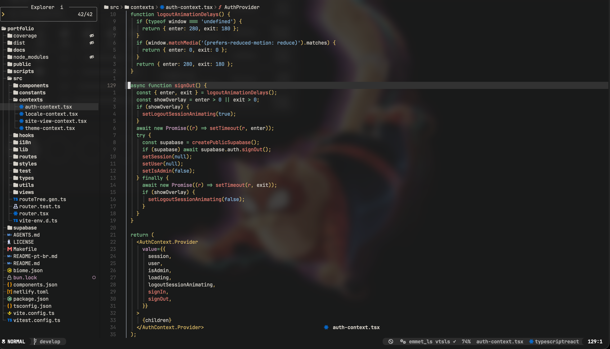

<div align="center">


# Rosavim

**A modern, productive Neovim distribution ready for the real world.**

[](https://neovim.io)
[](https://www.lua.org)
[](LICENSE)

*Turn your terminal into a full-featured IDE, no hassle.*

🇺🇸 **English** · 🇧🇷 **[Português](README.pt-br.md)**

| | |
|:---:|:---:|
|  |  |
|  |  |

</div>

## What is Rosavim?

Rosavim is for developers who want a complete, fast, good-looking setup without spending a weekend wiring one together. Support for the most popular languages and frameworks is already in place, so you can clone it and start coding.

It runs on **Lazy.nvim** and loads plugins only when they are needed, so startup stays quick. On top of that it brings its own set of **"rosa" plugins** (terminal, test runner, file operations, project navigator, and more), which covers most of what you would otherwise install by hand.

## Quick Start

```bash
# Back up your current config (if any)
mv ~/.config/nvim ~/.config/nvim.bak

# Clone Rosavim
git clone https://github.com/pedrorcruzz/rosavim.git ~/.config/nvim

# Open Neovim, the plugins install on their own
nvim
```

On first launch, **Lazy.nvim** installs the plugins and **Mason** sets up LSP servers, formatters, linters, and debug adapters.

<details>
<summary><b>Requirements</b></summary>

<br>

| Dependency | Version |
|:-----------|:--------|
| **Neovim** | **>= 0.12** |
| Git | >= 2.19 |
| Node.js | >= 18 |
| Python | >= 3.10 |
| [Nerd Font](https://www.nerdfonts.com/) | Any |
| [ripgrep](https://github.com/BurntSushi/ripgrep) | Any |

**Recommended:** [lazygit](https://github.com/jesseduffield/lazygit) (Git UI) · [yazi](https://github.com/sxyazi/yazi) (file manager) · [chafa](https://hpjansson.org/chafa/) (dashboard image)

Full step-by-step guide (backup, dependencies, troubleshooting): **[Installation Manual](docs/manual/installation.md)**.

</details>

## Documentation

Detailed guides live in [`docs/manual`](docs/manual/):

[Installation](docs/manual/installation.md) · [Keybindings](docs/manual/keybinds.md) · [Plugins](docs/manual/plugins.md) · [Languages](docs/manual/languages.md) · [Debugging](docs/manual/debugging.md) · [Customization](docs/manual/customization.md) · [Toggles](docs/manual/toggles.md)

## Features

<details>
<summary><b>Editor & Navigation</b></summary>

<br>

- **blink.cmp**, a completion engine written in Rust that keeps up even in big files
- **Native snippets** (`vim.snippet`) + friendly-snippets, managed by **Rosasnippets**, an interactive panel with fuzzy search, per-language starter presets, and live preview
- **Native Treesitter** (Neovim 0.12+) for precise highlighting and indentation
- **Format on save** (conform.nvim) and **auto-save** on focus loss
- **Snacks Picker** for fuzzy finding files, grep, and buffers
- **Flash.nvim** for jump-anywhere navigation with visual labels
- **GrugFar** for project-wide search and replace (ripgrep)
- **Persistent toggles**, so your UI settings are still there next time you open the editor

</details>

<details>
<summary><b>Git, Debug & Testing</b></summary>

<br>

- **Gitsigns** for inline change indicators and per-line blame
- Built-in **lazygit** integration
- **DAP**, a full debugger with UI, breakpoints, and inline variable inspection
- **Rosatest**, the built-in test runner with a popup UI: run the nearest test, the whole file, or everything. Works with Go, Jest, Vitest, Pytest, Pest, PHPUnit, and Java

</details>

<details>
<summary><b>AI</b></summary>

<br>

- **GitHub Copilot** integrated into completion
- **RosaAI**, native integration with AI CLIs (Claude, Cursor, OpenClaude, OpenCode, Gemini, and others) in a themed, resizable window inside the editor, with a preview prompt

</details>

<details>
<summary><b>UI & Appearance</b></summary>

<br>

- **4 built-in themes**: **Rosamin** (default, minimal), **Rosavintage** (warm, earthy), **Rosanight** (monochrome, OLED black), and **Rosajet** (JetBrains palette), all with dark/light mode and transparency
- **Dashboard**, **Lualine** statusline (selectable separators), **Bufferline** tabs, **Dropbar** breadcrumbs, **Incline** floating filenames, and **Noice** for modern messages
- One-shortcut **dark/light** and **theme** switching

</details>

<details>
<summary><b>Built-in "Rosa" plugins</b></summary>

<br>

| Plugin | What it does |
|:-------|:-------------|
| **Rosaterm** | Float and split terminals, native, no external dependencies. Cycle floats, themed title chip, persistent toggles |
| **Rosatest** | Test runner with popup results (Go, Jest, Vitest, Pytest, Pest, PHPUnit, Java) |
| **Rosakit** | Language-aware project navigator with automatic stack detection (React, Next, Vue, Angular, Svelte, Nest, Express, Go, Django, FastAPI, Laravel, Spring), monorepos included |
| **Rosafile** | File operations menu: create, rename, duplicate, delete, info |
| **Rosapreview** | LSP preview (definition, type, implementation, references) in a floating window |
| **Rosapoon** | Bookmark and jump between frequently used files, scoped per git repo |
| **Rosadirs** | Manage Projects & Obsidian vault directories at runtime |
| **Rosasnippets** | Snippet manager: browse and search your snippets, 4-step creation wizard with per-language starter presets (plus your own), live preview, hot reload into completion |
| **Rosapick** | Visual window picker with letter labels |
| **Rosamaximize** | Maximize the current window and restore the full layout, with a `max` badge and a lualine indicator (configurable via `<leader>lam`) |
| **Rosazen** | Distraction-free mode: maximizes and centers the current window, hides all UI chrome, keeps floating tools (Rosaterm/RosaAI/Yazi/Lazygit) usable, and persists across sessions |
| **Rosatag** | Auto close and live rename html/jsx tags, no treesitter parser needed (`<leader>kr` to rename, toggles in `<leader>lat`) |
| **Rosavisualmulti** | Multi-cursor editing built on extmarks: occurrence (`<C-n>`), column (`<C-Up>`/`<C-Down>`) and regex cursors, insert replicated to every cursor, arbitrary normal commands and macros, align, rename popup, and a dynamic action menu (`<leader>kv`) |
| **Rosayank** | Persistent yank history (ring buffer) |
| **Rosasave** | Debounced auto-save |
| **Rosasweep** | Auto-closes inactive buffers |

</details>

<details>
<summary><b>Extras</b></summary>

<br>

- **Database Client** (vim-dadbod) with UI for SQL
- **Obsidian** integration for notes
- **Discord Presence**

> The plugin system is modular, so add, remove, or swap plugins to match how you work.

</details>

## Languages & Frameworks

Full support (LSP, formatting, linting, testing, debugging) for the most popular stacks:

<details>
<summary><b>Show support table</b></summary>

<br>

| Language | LSP | Formatter | Linter | Tests | Debug |
|:---------|:---:|:---------:|:------:|:-----:|:-----:|
| **TypeScript / JavaScript** | tsc | Biome / Prettier | Biome / eslint_d | Jest / Vitest | - |
| **React / JSX / TSX** | tsc | Biome / Prettier | Biome / eslint_d | Jest / Vitest | - |
| **Go** | gopls | goimports | golangci-lint | gotestsum | Delve |
| **Python** | basedpyright | autopep8 | Mypy / Pylint | pytest | debugpy |
| **Java** | JDTLS | google-java-format | Checkstyle | Gradle | Remote Attach |
| **PHP / Laravel** | Intelephense | php-cs-fixer | phpcs | Pest | Xdebug |
| **HTML / CSS** | Emmet + Tailwind | Prettier | djlint | - | - |
| **SQL** | sqlls | sql_formatter | - | - | - |
| **Lua** | lua_ls | StyLua | - | - | - |
| **JSON** | json_ls | Prettier | Biome | - | - |

</details>

> **Not listed?** Rosavim leans on **Mason** for tooling, so Rust, C/C++, Kotlin, Ruby, Elixir, Zig, and plenty of others take a couple of minutes to add.

## Themes

Rosavim comes with 4 themes of its own, all wired into the dark/light and transparency toggles.

<details>
<summary><b>Rosamin</b>: minimal, clean, focused (default)</summary>

<br>

| Code (Dark) | Dashboard (Dark) | Code (Light) | Transparent |
|:------------|:-----------------|:-------------|:------------|
|  |  |  |  |

</details>

<details>
<summary><b>Rosavintage</b>: warm, earthy tones</summary>

<br>

| Code (Dark) | Dashboard (Dark) | Code (Light) | Dashboard (Light) | Transparent |
|:------------|:-----------------|:-------------|:------------------|:------------|
|  |  |  |  |  |

</details>

<details>
<summary><b>Rosanight</b>: monochrome (OLED black and cool white)</summary>

<br>

A night theme with no color at all: OLED black (`#000000`) behind a cool white and grey ramp. In light mode the whole thing flips onto a soft `#D3D2CE` base. Dark, light, and transparency are all supported.

</details>

<details>
<summary><b>Rosajet</b>: JetBrains IDE palette (ported)</summary>

<br>

A port of the JetBrains color scheme. The dark side follows IntelliJ IDEA's New
UI: `#272729` in the editor, `#191A1C` in the explorer and tab strip (press
`<leader>lqij` to swap the two) and `#2B2D30` in the tool windows. Light mode
follows IntelliJ Light (`#FFFFFF` and `#F7F8FA`). The syntax roles are the IDE's
own: orange or blue keywords, green strings, magenta constants and properties,
olive annotations, and plain text for classes and identifiers. Ported from
[nickkadutskyi/jb.nvim](https://github.com/nickkadutskyi/jb.nvim), and the
lualine mode chips reuse the IdeaVim mode colors. Dark, light, and transparency
are all supported.

</details>

## Key Shortcuts

> Leader key: `<Space>` · Press `<leader>` anytime to open **which-key** and browse everything.

<details>
<summary><b>Show essential shortcuts</b></summary>

<br>

**Files & Navigation**
| Key | Action |
|:----|:-------|
| `<leader><space>` | Find files |
| `<leader>e` | File explorer |
| `<leader>y` | Yazi file manager |
| `<leader>;` | Dashboard |
| `s` | Flash jump |
| `<leader>oo` / `<leader>oe` | Rosapoon: pin / menu |

**Search & Code**
| Key | Action |
|:----|:-------|
| `<leader>sg` | Live grep |
| `<leader>sw` | Grep word under cursor |
| `<leader>lee` | Search & replace (GrugFar) |
| `gd` / `gr` / `gI` | Definition / references / implementation |
| `gp` | Rosapreview definition |
| `<leader>lf` | Format file |
| `<leader>xx` | Rosafile menu |
| `<leader>kk` | Rosakit menu |
| `<C-n>` | Rosavisualmulti: select word / next occurrence |
| `<leader>kvv` | Rosavisualmulti menu |

**Git, Test & Debug**
| Key | Action |
|:----|:-------|
| `<leader>gg` | Lazygit |
| `<leader>gt` | Toggle git blame |
| `<leader>nn` | Rosatest menu |
| `<leader>nf` | Run file tests |
| `<leader>ds` | Start / continue debug |
| `<leader>db` | Toggle breakpoint |

**Windows, Terminal & AI**
| Key | Action |
|:----|:-------|
| `<C-h/j/k/l>` | Move between splits |
| `<leader>m` | Rosapick (window picker) |
| `<leader>S` | Rosapick (window picker, left-hand alias) |
| `<leader>cm` | Rosamaximize |
| `<leader>lz` | Rosazen (distraction-free mode) |
| `<C-\>` / `<S-z>` | Rosaterm: toggle float |
| `<S-x>` | Rosaterm: horizontal terminal |
| `<leader>cii` / `<leader>cie` | Rosaterm: vertical / horizontal split |
| `<leader>aa` | RosaAI: toggle CLI |

**UI & Misc**
| Key | Action |
|:----|:-------|
| `<leader>lqt` | Toggle dark/light mode |
| `<leader>lqs` | Switch theme (rosamin / rosavintage / rosanight / rosajet) |
| `<leader>lqi` | Invert BG (rosajet `j` / rosamin `m` / rosavintage `v`) |
| `<leader>lqy` | Toggle lualine bar-y transparency |
| `<leader>lp` | Rosadirs (manage project dirs) |
| `<leader>lo` | Rosasnippets (snippet manager) |
| `<leader>ll` | Toggle statusline |
| `<leader>ly` | Toggle cursor shape (block ↔ thin bar) |
| `<leader>lY` | Toggle current-line highlight |
| `kj` | Exit insert mode |

Full reference: **[Keybindings Manual](docs/manual/keybinds.md)**.

</details>

## Project Structure

<details>
<summary><b>Show structure</b></summary>

<br>

```
~/.config/nvim/
├── init.lua                       # Entry point
├── lua/rosavim/
│   ├── init.lua                   # Bootstrap
│   ├── config/                    # options, keybinds, appearance, autocmds, toggles, focus
│   ├── plugins/
│   │   ├── env/                   # LSP, Mason, Treesitter, DAP, lint, format, git
│   │   ├── ai/                    # Copilot, RosaAI
│   │   ├── ui/                    # themes, statusline, dashboard, bufferline, noice
│   │   ├── editor/                # terminal, navigation, file ops, projects
│   │   ├── coding/                # flash, surround, multi-cursor, refactoring
│   │   ├── language/              # language-specific (Laravel, Spring, Django, etc)
│   │   └── test/                  # Rosatest
│   ├── rosa_plugins/              # built-in plugins (see Features)
│   │   ├── rosaterm/  rosatest/  rosakit/  rosafile/
│   │   ├── rosapreview/  rosapoon/  rosadirs/  rosapick/  rosasnippets/
│   │   ├── rosamaximize/  rosazen/  rosayank/  rosasave/  rosasweep/
│   │   ├── rosatag/
│   │   └── rosaai/
│   └── rosa_themes/
│       ├── rosamin/               # default theme (minimal)
│       ├── rosavintage/          # earthy, warm theme
│       ├── rosanight/            # minimalist monochrome (OLED)
│       └── rosajet/              # JetBrains IDE palette (ported), Invert BG in config/invert_bg.lua
├── lsp/                           # individual LSP configs
├── snippets/                      # VSCode-format snippets (managed by Rosasnippets, <leader>lo)
└── assets/                        # logo and screenshots
```

</details>

---

<div align="center">

Built with care by **Pedro Rosa**

</div>
