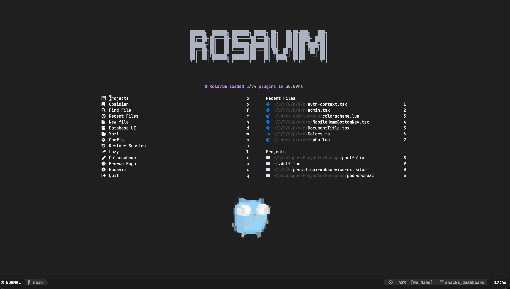
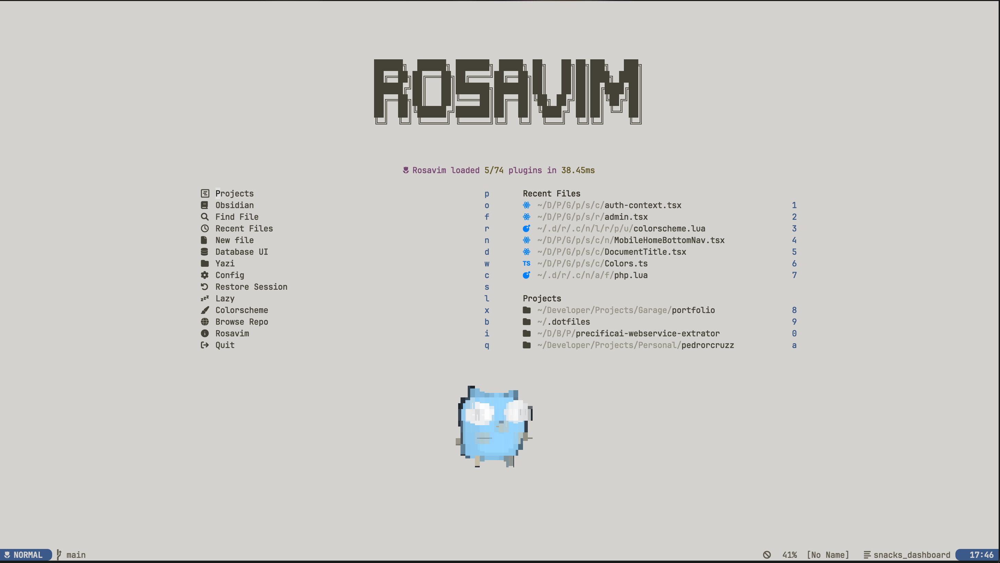
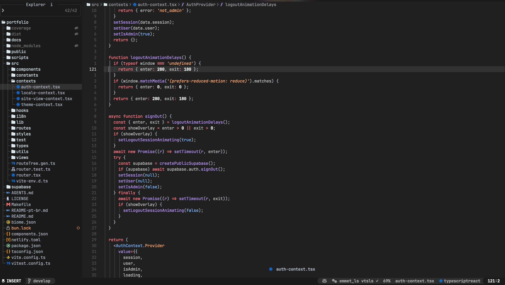
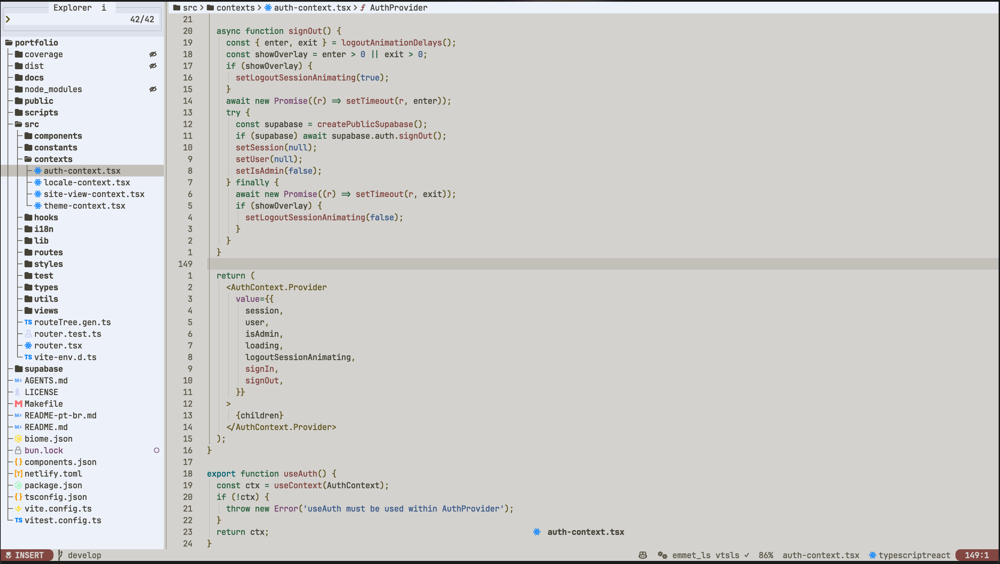
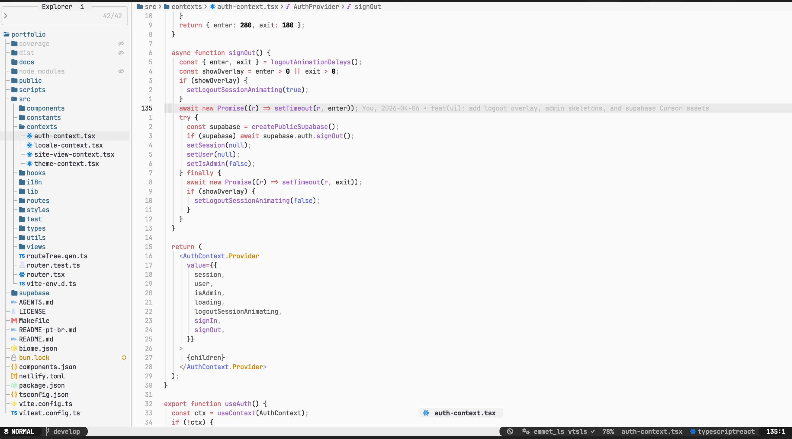
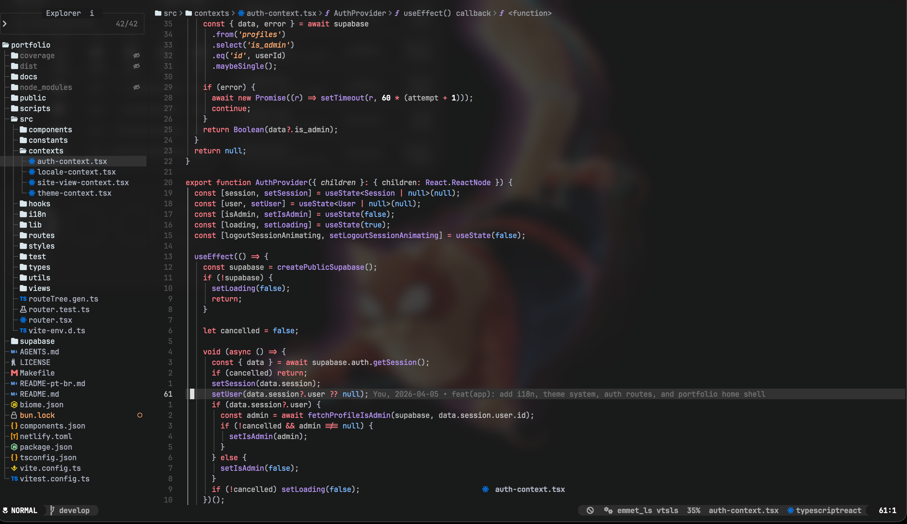
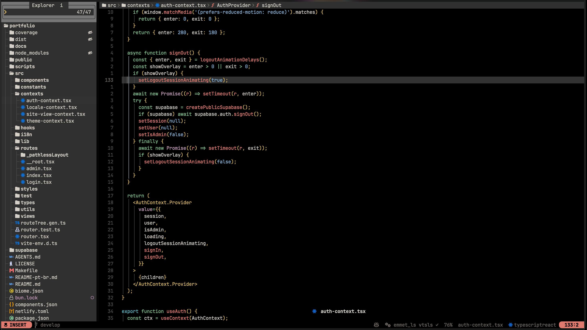
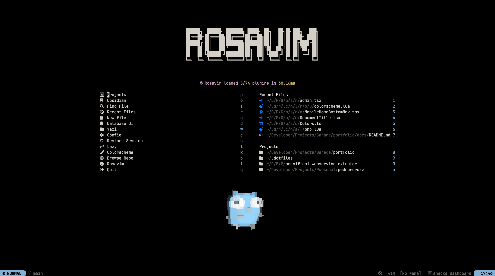
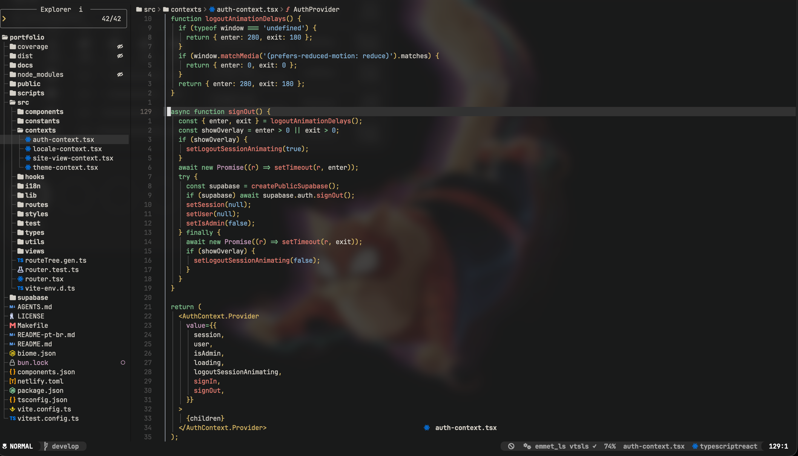

<div align="center">


# Rosavim

**Uma distribuição Neovim moderna, produtiva e pronta para o mundo real.**

[](https://neovim.io)
[](https://www.lua.org)
[](LICENSE)

*Transforme seu terminal em uma IDE completa, sem complicações.*

🇧🇷 **Português** · 🇺🇸 **[English](README.md)**

| | |
|:---:|:---:|
|  |  |
|  |  |

</div>

## O que é Rosavim?

Rosavim é para quem quer um ambiente completo, rápido e bonito sem passar um fim de semana montando tudo do zero. O suporte para as principais linguagens e frameworks já está pronto, então é só clonar e começar a codar.

Ele roda em cima do **Lazy.nvim** e só carrega os plugins quando eles são necessários, então o startup continua rápido. Além disso traz o próprio conjunto de **plugins "rosa"** (terminal, test runner, operações de arquivo, navegador de projeto e mais), que cobre boa parte do que você instalaria na mão.

## Início Rápido

```bash
# Faça backup da sua config atual (se houver)
mv ~/.config/nvim ~/.config/nvim.bak

# Clone o Rosavim
git clone https://github.com/pedrorcruzz/rosavim.git ~/.config/nvim

# Abra o Neovim, os plugins se instalam sozinhos
nvim
```

Na primeira execução, o **Lazy.nvim** instala os plugins e o **Mason** configura LSP servers, formatters, linters e adaptadores de debug.

<details>
<summary><b>Requisitos</b></summary>

<br>

| Dependência | Versão |
|:------------|:-------|
| **Neovim** | **>= 0.12** |
| Git | >= 2.19 |
| Node.js | >= 18 |
| Python | >= 3.10 |
| [Nerd Font](https://www.nerdfonts.com/) | Qualquer |
| [ripgrep](https://github.com/BurntSushi/ripgrep) | Qualquer |

**Recomendado:** [lazygit](https://github.com/jesseduffield/lazygit) (UI de Git) · [yazi](https://github.com/sxyazi/yazi) (file manager) · [chafa](https://hpjansson.org/chafa/) (imagem do dashboard)

Guia completo passo a passo (backup, dependências, troubleshooting): **[Manual de Instalação](docs/manual/installation.pt-br.md)**.

</details>

## Documentação

Guias detalhados ficam em [`docs/manual`](docs/manual/):

[Instalação](docs/manual/installation.pt-br.md) · [Atalhos](docs/manual/keybinds.pt-br.md) · [Plugins](docs/manual/plugins.pt-br.md) · [Linguagens](docs/manual/languages.pt-br.md) · [Debugging](docs/manual/debugging.pt-br.md) · [Customização](docs/manual/customization.pt-br.md) · [Toggles](docs/manual/toggles.pt-br.md)

## Funcionalidades

<details>
<summary><b>Editor & Navegação</b></summary>

<br>

- **blink.cmp**, engine de completion escrita em Rust que aguenta arquivo grande sem travar
- **Snippets nativos** (`vim.snippet`) + friendly-snippets, gerenciados pelo **Rosasnippets**, um painel interativo com busca fuzzy, presets iniciais por linguagem e preview ao vivo
- **Treesitter nativo** (Neovim 0.12+) para highlighting e indentação precisos
- **Format on save** (conform.nvim) e **auto-save** ao perder o foco
- **Snacks Picker** para fuzzy finding de arquivos, grep e buffers
- **Flash.nvim** para navegação instantânea com labels visuais
- **GrugFar** para search e replace no projeto inteiro (ripgrep)
- **Toggles persistentes**, ou seja, suas configurações de UI continuam lá na próxima vez que abrir o editor

</details>

<details>
<summary><b>Git, Debug & Testes</b></summary>

<br>

- **Gitsigns** para indicadores de mudança inline e blame por linha
- Integração nativa com **lazygit**
- **DAP**, um debugger completo com UI, breakpoints e inspeção de variáveis inline
- **Rosatest**, o test runner próprio com popup de resultados: roda o teste mais próximo, o arquivo inteiro ou tudo. Funciona com Go, Jest, Vitest, Pytest, Pest, PHPUnit e Java

</details>

<details>
<summary><b>IA</b></summary>

<br>

- **GitHub Copilot** integrado ao completion
- **RosaAI**, integração nativa com CLIs de IA (Claude, Cursor, OpenClaude, OpenCode, Gemini e outras) numa janela temática e redimensionável dentro do editor, com preview do prompt

</details>

<details>
<summary><b>UI & Aparência</b></summary>

<br>

- **4 temas próprios**: **Rosamin** (padrão, minimal), **Rosavintage** (quente, terroso), **Rosanight** (monocromático, OLED preto) e **Rosajet** (palette das JetBrains), todos com dark/light mode e transparência
- **Dashboard**, statusline **Lualine** (separadores selecionáveis), abas **Bufferline**, breadcrumbs **Dropbar**, nomes flutuantes **Incline** e **Noice** para mensagens modernas
- Troca de **dark/light** e de **tema** com um atalho

</details>

<details>
<summary><b>Plugins próprios "Rosa"</b></summary>

<br>

| Plugin | O que faz |
|:-------|:----------|
| **Rosaterm** | Terminais float e split nativos, sem dependências externas. Cicla floats, chip de título temático, toggles persistentes |
| **Rosatest** | Test runner com popup de resultados (Go, Jest, Vitest, Pytest, Pest, PHPUnit, Java) |
| **Rosakit** | Navegador de projeto com detecção automática de stack (React, Next, Vue, Angular, Svelte, Nest, Express, Go, Django, FastAPI, Laravel, Spring), monorepos incluídos |
| **Rosafile** | Menu de operações de arquivo: criar, renomear, duplicar, deletar, info |
| **Rosapreview** | Preview de LSP (definição, tipo, implementação, referências) em janela flutuante |
| **Rosapoon** | Marca e salta entre arquivos frequentes, com escopo por repositório git |
| **Rosadirs** | Gerencia diretórios de Projetos & vaults do Obsidian em runtime |
| **Rosasnippets** | Gerenciador de snippets: navegue e busque seus snippets, wizard de criação em 4 etapas com presets por linguagem (e os seus próprios), preview ao vivo, hot reload no autocomplete |
| **Rosapick** | Seletor visual de janelas com labels de letra |
| **Rosamaximize** | Maximiza a janela atual e restaura o layout completo, com um badge `max` e um indicador na lualine (configurável via `<leader>lam`) |
| **Rosazen** | Modo sem distrações: maximiza e centraliza a janela atual, esconde toda a UI, mantém as ferramentas flutuantes (Rosaterm/RosaAI/Yazi/Lazygit) usáveis, e persiste entre sessões |
| **Rosatag** | Fecha e renomeia tags html/jsx ao vivo, sem precisar de parser do treesitter (`<leader>kr` para renomear, toggles em `<leader>lat`) |
| **Rosavisualmulti** | Edição com múltiplos cursores sobre extmarks: cursores por ocorrência (`<C-n>`), coluna (`<C-Up>`/`<C-Down>`) e regex, insert replicado em todos os cursores, comandos normais e macros, align, popup de rename, e menu dinâmico de ações (`<leader>kv`) |
| **Rosayank** | Histórico de yank persistente (ring buffer) |
| **Rosasave** | Auto-save com debounce |
| **Rosasweep** | Fecha buffers inativos automaticamente |

</details>

<details>
<summary><b>Extras</b></summary>

<br>

- **Database Client** (vim-dadbod) com UI para SQL
- **Obsidian** integração para notas
- **Discord Presence**

> O sistema de plugins é modular, então adicione, remova ou troque plugins para adaptar ao seu jeito de trabalhar.

</details>

## Linguagens & Frameworks

Suporte completo (LSP, formatação, linting, testes e debug) para as principais stacks:

<details>
<summary><b>Ver tabela de suporte</b></summary>

<br>

| Linguagem | LSP | Formatter | Linter | Testes | Debug |
|:----------|:---:|:---------:|:------:|:------:|:-----:|
| **TypeScript / JavaScript** | tsgo | Biome / Prettier | Biome / eslint_d | Jest / Vitest | - |
| **React / JSX / TSX** | tsgo | Biome / Prettier | Biome / eslint_d | Jest / Vitest | - |
| **Go** | gopls | goimports | golangci-lint | gotestsum | Delve |
| **Python** | basedpyright | autopep8 | Mypy / Pylint | pytest | debugpy |
| **Java** | JDTLS | google-java-format | Checkstyle | Gradle | Remote Attach |
| **PHP / Laravel** | Intelephense | php-cs-fixer | phpcs | Pest | Xdebug |
| **HTML / CSS** | Emmet + Tailwind | Prettier | djlint | - | - |
| **SQL** | sqlls | sql_formatter | - | - | - |
| **Lua** | lua_ls | StyLua | - | - | - |
| **JSON** | json_ls | Prettier | Biome | - | - |

</details>

> **Não encontrou sua linguagem?** O Rosavim usa o **Mason** para as ferramentas, então Rust, C/C++, Kotlin, Ruby, Elixir, Zig e várias outras levam poucos minutos para entrar.

## Temas

O Rosavim vem com 4 temas próprios, todos ligados aos toggles de dark/light e transparência.

<details>
<summary><b>Rosamin</b>: minimal, limpo e focado (padrão)</summary>

<br>

| Code (Dark) | Dashboard (Dark) | Code (Light) | Transparente |
|:------------|:-----------------|:-------------|:-------------|
|  |  |  |  |

</details>

<details>
<summary><b>Rosavintage</b>: tons quentes e terrosos</summary>

<br>

| Code (Dark) | Dashboard (Dark) | Code (Light) | Dashboard (Light) | Transparente |
|:------------|:-----------------|:-------------|:------------------|:-------------|
|  |  |  |  |  |

</details>

<details>
<summary><b>Rosanight</b>: monocromático (OLED preto e branco frio)</summary>

<br>

Um tema noturno sem cor nenhuma: fundo OLED preto (`#000000`) com uma rampa de branco e cinza frio. No modo light tudo isso vira uma base suave `#D3D2CE`. Dark, light e transparência funcionam todos.

</details>

<details>
<summary><b>Rosajet</b>: palette das IDEs JetBrains (portado)</summary>

<br>

Um port do esquema de cores das IDEs JetBrains. O dark segue a New UI do IntelliJ
IDEA: `#272729` no editor, `#191A1C` no explorer e nas tabs (aperte
`<leader>lqij` para trocar os dois) e `#2B2D30` nas tool windows. O light segue o
IntelliJ Light (`#FFFFFF` e `#F7F8FA`). Os papéis de sintaxe são os da própria
IDE: keywords laranja ou azul, strings verdes, constantes e propriedades magenta,
annotations oliva e texto normal para classes e identificadores. Portado de
[nickkadutskyi/jb.nvim](https://github.com/nickkadutskyi/jb.nvim), e os chips de
modo do lualine reusam as cores de modo do IdeaVim. Dark, light e transparência
funcionam todos.

</details>

## Atalhos Principais

> Leader: `<Space>` · Pressione `<leader>` a qualquer momento para abrir o **which-key** e explorar tudo.

<details>
<summary><b>Ver atalhos essenciais</b></summary>

<br>

**Arquivos & Navegação**
| Atalho | Ação |
|:-------|:-----|
| `<leader><space>` | Buscar arquivos |
| `<leader>e` | File explorer |
| `<leader>y` | Yazi file manager |
| `<leader>;` | Dashboard |
| `s` | Flash jump |
| `<leader>oo` / `<leader>oe` | Rosapoon: pin / menu |

**Busca & Código**
| Atalho | Ação |
|:-------|:-----|
| `<leader>sg` | Grep ao vivo |
| `<leader>sw` | Grep da palavra sob o cursor |
| `<leader>lee` | Search & replace (GrugFar) |
| `gd` / `gr` / `gI` | Definição / referências / implementação |
| `gp` | Rosapreview definição |
| `<leader>lf` | Formatar arquivo |
| `<leader>xx` | Menu Rosafile |
| `<leader>kk` | Menu Rosakit |
| `<C-n>` | Rosavisualmulti: selecionar palavra / próxima ocorrência |
| `<leader>kvv` | Menu Rosavisualmulti |

**Git, Testes & Debug**
| Atalho | Ação |
|:-------|:-----|
| `<leader>gg` | Lazygit |
| `<leader>gt` | Toggle git blame |
| `<leader>nn` | Menu Rosatest |
| `<leader>nf` | Rodar testes do arquivo |
| `<leader>ds` | Iniciar / continuar debug |
| `<leader>db` | Toggle breakpoint |

**Janelas, Terminal & IA**
| Atalho | Ação |
|:-------|:-----|
| `<C-h/j/k/l>` | Mover entre splits |
| `<leader>m` | Rosapick (seletor de janela) |
| `<leader>cm` | Rosamaximize |
| `<leader>lz` | Rosazen (modo sem distrações) |
| `<C-\>` / `<S-z>` | Rosaterm: toggle float |
| `<S-x>` | Rosaterm: terminal horizontal |
| `<leader>cii` / `<leader>cie` | Rosaterm: split vertical / horizontal |
| `<leader>aa` | RosaAI: toggle CLI |

**UI & Diversos**
| Atalho | Ação |
|:-------|:-----|
| `<leader>lqt` | Alternar dark/light mode |
| `<leader>lqs` | Trocar tema (rosamin / rosavintage / rosanight / rosajet) |
| `<leader>lqi` | Inverter BG (rosajet `j` / rosamin `m` / rosavintage `v`) |
| `<leader>lqy` | Alternar transparência da barra-y do lualine |
| `<leader>lp` | Rosadirs (gerenciar diretórios) |
| `<leader>lo` | Rosasnippets (gerenciador de snippets) |
| `<leader>ll` | Toggle statusline |
| `<leader>ly` | Alternar formato do cursor (bloco ↔ barra fina) |
| `<leader>lY` | Alternar faixa da linha atual |
| `kj` | Sair do insert mode |

Referência completa: **[Manual de Atalhos](docs/manual/keybinds.pt-br.md)**.

</details>

## Estrutura do Projeto

<details>
<summary><b>Ver estrutura</b></summary>

<br>

```
~/.config/nvim/
├── init.lua                       # Ponto de entrada
├── lua/rosavim/
│   ├── init.lua                   # Bootstrap
│   ├── config/                    # options, keybinds, appearance, autocmds, toggles, focus
│   ├── plugins/
│   │   ├── env/                   # LSP, Mason, Treesitter, DAP, lint, format, git
│   │   ├── ai/                    # Copilot, RosaAI
│   │   ├── ui/                    # temas, statusline, dashboard, bufferline, noice
│   │   ├── editor/                # terminal, navegação, operações de arquivo, projetos
│   │   ├── coding/                # flash, surround, multi-cursor, refactoring
│   │   ├── language/              # específicos de linguagem (Laravel, Spring, Django, etc)
│   │   └── test/                  # Rosatest
│   ├── rosa_plugins/              # plugins próprios (ver Funcionalidades)
│   │   ├── rosaterm/  rosatest/  rosakit/  rosafile/
│   │   ├── rosapreview/  rosapoon/  rosadirs/  rosapick/  rosasnippets/
│   │   ├── rosamaximize/  rosazen/  rosayank/  rosasave/  rosasweep/
│   │   ├── rosatag/
│   │   └── rosaai/
│   └── rosa_themes/
│       ├── rosamin/               # tema padrão (minimal)
│       ├── rosavintage/          # tema quente e terroso
│       ├── rosanight/            # monocromático minimalista (OLED)
│       └── rosajet/              # palette das IDEs JetBrains (portado), Inverter BG em config/invert_bg.lua
├── lsp/                           # configs individuais de LSP
├── snippets/                      # snippets em formato VSCode (gerenciados pelo Rosasnippets, <leader>lo)
└── assets/                        # logo e screenshots
```

</details>

---

<div align="center">

Construído com carinho por **Pedro Rosa**

</div>
